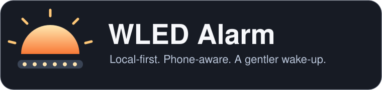

<p align="center">
	
</p>

<p align="center">
	<a href="LICENSE"></a>
	<a href="usermods/wecker_presence/readme.md"></a>
	<a href="usermods/wecker_presence/iphone-shortcut.md"></a>
</p>

# WLED Alarm

**A sunrise light alarm that runs on your LED controller, not in your browser.**

[WLED Alarm](https://github.com/FindusFM22/wledAlarm) is an independently maintained project based on [WLED](https://github.com/wled/WLED). It adds local light alarms, phone-presence checks and native iPhone Clock synchronization while retaining WLED's LED controls, effects, segments and presets.

For iPhone integration, the Shortcut uploads the alarm list. **WLED handles enabled states, repeat weekdays, upcoming dates and the light curve.** No Home Assistant, router login or additional iPhone app is needed.

> [!IMPORTANT]
> This is development firmware, not an official WLED release or a guaranteed wake-up device. Keep an acoustic alarm as your primary wake-up alarm. Phone presence is an imperfect device-reachability check, not proof that a person is at home.

## What you get

| Feature | Behavior |
|---|---|
| Sunrise light alarm | Rise to target brightness at the wake time, hold, then fade out. RGBW sunrise or a visual preset. |
| iPhone Clock integration | Store up to **32 normal Clock alarms** on ESP32. WLED resolves their recurrence; no next-date calculation in the Shortcut. |
| Read-only iPhone list | See names, times, weekdays and enabled/disabled states in the web UI, separate from manual alarms. |
| Manual alarms | Up to **16** recurring or dated one-shot alarms with their own light settings. |
| Everyday controls | Stop, snooze, skip-next and a 30-second manual preview. |
| Presence-aware scheduling | Start checks **90 minutes before light start**: every 15 minutes, every 5 minutes in the last 30 minutes, and every 10 minutes while running. Positive evidence is valid for 60 minutes. |
| Local storage | Confirmed saves, stale-update protection and persistent execution markers. No daily re-upload is needed for a stored recurring iPhone list. |
| Familiar WLED controls | Existing LED configuration, ordinary timers, effects, segments and presets remain available. |

### A wake time is not a light-start time

With a **07:45** wake time and a **30-minute** rise:

```text
05:45          07:15          07:45           hold          fade out
presence       light starts  target brightness reached
checks begin
```

Presence windows refer to **light start**. Wake times mean the target brightness should be reached, not that the strip first switches on.

## Hardware and prerequisites

- **ESP32** is required for the persistent iPhone alarm-list API. The dedicated example targets a classic ESP32-WROOM-32(S).
- **ESP8266** supports manual light alarms; it does not support iPhone list storage and reports `supported:false` for that integration.
- Configure the actual LED type, count, color order, GPIO and safe current limit in WLED. This project does not infer or overwrite your wiring.
- Use a trusted home IPv4 network without guest-network/client isolation. Reserve the controller and phone addresses.
- Enable NTP and choose the correct timezone. The default public time server can be replaced with a suitable local NTP server.
- For an iPhone, keep its private Wi-Fi address **fixed for the home network** and reserve that address in the router. Do not disable address privacy globally.

## Quick start

### 1. Build firmware with the alarm backend

Install **Node.js 20+** and **PlatformIO**, then work from the repository root.

Copy only the `light_alarm_esp32` section from [platformio_override.sample.ini](platformio_override.sample.ini) into your local `platformio_override.ini`. Preserve any existing board/upload settings. The example includes `wecker_presence`; add other usermods explicitly if your installation needs them.

```sh
npm ci
npm run build
pio run -e light_alarm_esp32
```

The application image is `.pio/build/light_alarm_esp32/firmware.bin`. Flash it using the appropriate USB or WLED OTA procedure for your board. Do not upload an ESP32 image to another MCU family or erase the filesystem just to update firmware.

`platformio_override.ini`, build outputs and personalized configuration are intentionally gitignored. Do not edit or commit generated `wled00/html_*.h` or `wled00/js_*.h` files.

### 2. Configure the controller

1. Set the LED hardware and current limit in WLED.
2. Enable NTP and select your timezone under **Time & Macros**.
3. Open `http://<wled-ip>/wecker.htm`, or use **Alarm** in the main WLED navigation.
4. Configure **Phone presence setup** and test the phone both awake and locked.
5. Enable the master alarm switch.

For a bedroom controller that should stay dark after a power outage, disable **Turn LEDs on after power up/reset** under **LED settings → Power up**. This is independent of the light-alarm master switch.

### 3. Choose how to provide alarms

**From an iPhone — recommended on ESP32**

- Enable the independent iPhone light profile once; see [profile setup](usermods/wecker_presence/readme.md#profile-setup).
- Build the small [iPhone list-sync Shortcut](usermods/wecker_presence/iphone-shortcut.md).
- Run it manually, check the confirmed result and verify the **iPhone alarms** section.
- Add **Clock → Is Closed → Run Immediately** as a personal automation.

The list contains all supplied normal Clock alarms, including disabled ones. No `WLED` label is required. Apple's Health/Sleep schedule is not imported.

**Directly in WLED — ESP32 or ESP8266**

Use **＋** to add manual alarms. Set the wake time, weekdays or one-shot date, then the rise/hold/fade settings. Use **Preview · 30 sec** before relying on a real scheduled test.

> [!WARNING]
> Manual and iPhone alarms are independent. If you want only the iPhone to determine wake-up times, disable unwanted **manual alarms**, not the master switch. A manual alarm wins an exact start-time tie.

## iPhone list API

Send the whole list to **`POST /wecker/sync/iphone/alarms`** with `Content-Type: application/json`:

```json
[
  {"label":"Work","enabled":true,"time":"07:45","repeat":"Weekdays"},
  {"label":"Weekend","enabled":true,"time":"08:30","repeat":["Saturday","Sunday"]},
  {"label":"Backup","enabled":false,"time":"07:50","repeat":[]}
]
```

`{"alarms":[...]}` is accepted too. The basic list request needs no client timestamp or configuration revision. Times use WLED's configured timezone; `Yes`/`No` and common English/German weekday text are also accepted.

| Endpoint | Purpose |
|---|---|
| `GET /wecker/sync/iphone/alarms` | Read the stored normalized list. |
| `GET /wecker/sync/iphone` | Read readiness, current/next wake, light start and storage status. |
| `GET` on the returned `resultUrl` | Confirm that a queued write was durably stored. |
| `GET /wecker/status` | Combined manual/iPhone schedule, runner and presence status. |

A POST returns **202 with `confirmed:false`** while queued. This is not a failure, but it is not a save confirmation either. Follow its `resultUrl` until HTTP 200 and `confirmed:true`; do not announce a successful save from the initial receipt.

An explicit `[]` clears only the managed iPhone list. Missing fields, unknown enabled/repeat values, parsing errors and transport failures never intentionally turn into a clear.

> [!CAUTION]
> The legacy single-wake API and generated `WLED Alarm Sync` template remain supported. A successful legacy sync replaces an existing list with one wake instant. **Do not attach both client types to automations.** The generator is [documented as legacy tooling](tools/ios-shortcuts/readme.md); use the manual list-sync guide for new installations.

See the [complete alarm API and storage contract](usermods/wecker_presence/readme.md) for field limits, profile revisions, optional timestamped requests and errors.

## Power outages, presence and safety

- Stored alarms and settings survive a normal reboot. Once the network/time source is available again, WLED resumes planning future occurrences without another iPhone upload.
- An already started/consumed occurrence is **not resumed after reboot**. This is the current anti-replay policy, not uninterrupted-power protection.
- A successful phone reply provides a **60-minute lease**. Earlier successes do not accumulate into an all-night authorization. If the phone sleeps through all relevant checks, the light alarm may be skipped.
- A phone left at home is not proof its owner is home. Departure shortly after a reply can remain undetected for up to an hour.
- The iPhone endpoints trust direct clients in the controller's own IPv4 subnet; they do **not** require the WLED PIN. Use an isolated, trusted LAN and do not expose them through port forwarding or reverse proxies.
- NVS-backed iPhone state is not included in the ordinary filesystem/configuration backup. Firmware downgrades and resets need the documented [storage/mode precautions](usermods/wecker_presence/readme.md#persistence-and-security).

Read [known limitations](usermods/wecker_presence/readme.md#known-limitations) before overnight use. Tests and successful saves do not guarantee that every real device/network combination will wake a sleeping phone or run every edge case correctly.

## Repository map

| Path | Contents |
|---|---|
| `usermods/wecker_presence/` | Alarm model, validation, storage, presence checks and WLED adapter. |
| `wled00/data/wecker.{htm,js,css}` | Alarm web UI source. |
| `tools/light-alarm-tests.cpp` | Native firmware-model regression tests. |
| `tools/light-alarm-browser-check.cjs` | Browser checks against compiled web assets and a mocked controller. |
| `tools/ios-shortcuts/` | Legacy single-wake Shortcut generator and mocked action-graph tests. |
| `AGENTS.md`, `docs/` | Contributor workflows, coding conventions and security guidance. |

## Development

```sh
npm test
npm run build
pio run -e light_alarm_esp32
```

Run `npm test` **before**, not concurrently with, firmware/browser builds: its web-build tests temporarily modify and restore source fixtures and generated headers. Rebuild the web assets afterwards.

Optional native memory/undefined-behavior checks:

```sh
LIGHT_ALARM_SANITIZE=1 node --test tools/light-alarm-test.js
```

The alarm logic has native tests; browser checks use a mocked controller. Native Clock property extraction, permissions and locked-phone execution must be verified on the actual iPhone. Successful compilation is not a physical-device certification.

See [CONTRIBUTING.md](CONTRIBUTING.md) for repository-specific contribution guidance and [AGENTS.md](AGENTS.md) for the build workflow. No source changes to `platformio.ini` are needed for personal board overrides.

## Credits and license

WLED Alarm retains the WLED codebase and its attribution. WLED was created by **Christian Schwinne (Aircoookie)** and developed by the [WLED contributors](https://kno.wled.ge/about/contributors/). Upstream LED features and hardware documentation are available at [kno.wled.ge](https://kno.wled.ge).

This project is licensed under the [EUPL 1.2 or later](LICENSE). Bundled dependencies retain their own licenses. AI-assisted additions are marked in source and retain references where applicable.

Use appropriate wiring, power distribution, fusing and current limits. Avoid strobe/lightning/high-speed effects if you are photosensitive. The license's warranty and liability exclusions apply; this firmware is not a safety-critical alarm system.
